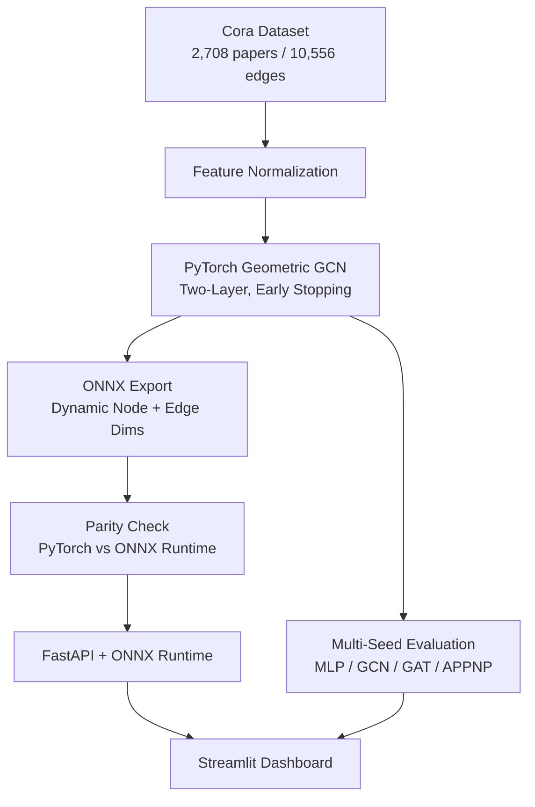

<div align="center">

# ⚡ CiteGraph

### Production-Oriented Citation-Graph Classification

**A Graph Convolutional Network reads paper content and citation structure. ONNX Runtime, FastAPI, and Streamlit turn the trained model into a validated, explorable inference service.**

[](https://www.python.org/)
[](https://pytorch-geometric.readthedocs.io/)
[](https://onnxruntime.ai/)
[](https://fastapi.tiangolo.com/)
[](https://streamlit.io/)
[](LICENSE)

🔗 **GitHub:** [rj1230/citegraph](https://github.com/rj1230/citegraph)

</div>

---

## 📌 Overview

**CiteGraph** is an end-to-end graph machine learning system for research-topic classification on the **Cora citation network**.

Each paper is a node with 1,433 bag-of-words features, and citations form the edges. A two-layer GCN learns from both paper content and local citation structure to predict one of seven research topics.

This is not a notebook-only model. The trained network is exported to ONNX, numerically validated against PyTorch, served through FastAPI, and explored in a Streamlit dashboard that shows how citation structure changes predictions.

---

## Architecture



### System Layers

| Layer | Responsibility |
|---|---|
| Modeling | Cora loading, feature normalization, GCN training, best-validation checkpointing |
| Evaluation | 10-seed benchmarking of MLP, GCN, GAT, and APPNP with mean and standard deviation |
| Export | ONNX export with dynamic node and edge dimensions and numerical parity validation |
| Serving | FastAPI service on ONNX Runtime with server-side normalization and request validation |
| Exploration | Streamlit dashboard for probabilities, confidence, and citation-dropout experiments |

---

## Key Features

### Graph-Aware Classification

- Two-layer GCN built with PyTorch Geometric
- Uses both node features and citation edges
- Classifies 2,708 Cora papers into 7 research topics
- **82.5% ± 0.8** test accuracy across 10 random seeds

### Reproducible Benchmarking

- MLP, GCN, GAT, and APPNP compared over 10 seeds
- Reports mean accuracy and standard deviation, not single-run results
- Feature-only MLP baseline isolates the value of the citation graph
- GCN improves accuracy by **24.1 percentage points** over the MLP

### ONNX Inference

- Trained GCN exported with dynamic node and edge dimensions
- ONNX Runtime outputs validated against PyTorch on the full graph and a 1,000-node subgraph
- Maximum output difference of approximately **1e-6**

### FastAPI Serving

- ONNX model served through ONNX Runtime
- Cached full-graph Cora predictions
- Custom subgraph inference
- Server-side feature normalization
- Incoming requests validated before inference

### Interactive Dashboard

- Sends paper neighborhoods to the FastAPI service
- Shows predicted topic, class probabilities, and confidence
- Citation-dropout slider demonstrates the contribution of graph structure
- Benchmark results visualized with error bars

---

## Evaluation

| Result | Value |
|---|---:|
| Dataset | Cora |
| Nodes / papers | 2,708 |
| Citation edges | 10,556 |
| Node features | 1,433 |
| Classes | 7 |
| Train / validation / test nodes | 140 / 500 / 1,000 |
| Evaluation seeds | 10 |
| Feature-only MLP accuracy | 58.4% |
| **GCN accuracy** | **82.5% ± 0.8** |
| APPNP accuracy | 83.1% |
| GCN improvement over MLP | **24.1 percentage points** |
| ONNX vs. PyTorch max output difference | ~1e-6 |

### Why Graph Structure Matters

A feature-only MLP sees only the words in each paper. It cannot use the fact that papers citing similar research tend to share a topic.

| Model | Uses Citation Graph | Accuracy |
|---|---|---:|
| MLP | No | 58.4% |
| **GCN** | **Yes** | **82.5% ± 0.8** |
| GAT | Yes | Benchmarked |
| APPNP | Yes | 83.1% |

### Model Selection

APPNP had the highest mean accuracy, but its margin over GCN was within roughly one standard deviation. GCN was deployed because it offers nearly equivalent accuracy, a simpler architecture, more reliable ONNX export, and easier serving.

---

## Reliability

| Risk | How It Is Handled |
|---|---|
| Single-run variance | Results reported as mean ± std over 10 seeds |
| Early stopping restoring last weights | Fixed best-validation checkpoint restoration (`state_dict()` returns live tensor references) |
| Export drift | ONNX outputs validated against PyTorch on the full graph and a 1,000-node subgraph |
| Malformed requests | Validated by the API before inference |
| Inconsistent preprocessing | Features normalized server-side, not by the client |

**Checkpointing fix:** correcting best-weight restoration, together with feature normalization and regularization, raised single-run accuracy from **78.4% to 82.6%**.

---

## API

Start the service:

```bash
uvicorn api.app:app --reload
```

Interactive docs: <http://127.0.0.1:8000/docs>

| Method | Endpoint | Purpose |
|---|---|---|
| GET | `/health` | API and model availability |
| GET | `/model-info` | Model and dataset metadata |
| POST | `/predict` | Inference on a provided graph and node indices |
| POST | `/predict/cora_node` | Inference for selected Cora nodes |

---

## Tech Stack

| Layer | Tools |
|---|---|
| Graph model | PyTorch Geometric (GCN) |
| Deep learning | PyTorch |
| Model export | ONNX |
| Inference runtime | ONNX Runtime |
| API | FastAPI |
| Dashboard | Streamlit |
| Evaluation | scikit-learn, NumPy, Pandas |
| Dataset | Cora / Planetoid |

---

## Project Structure

```text
citegraph/
├── api/
│   └── app.py                # FastAPI ONNX inference service
├── artifacts/
│   ├── gcn.pt                # Trained PyTorch model
│   └── simple_gcn_cora.onnx  # Exported ONNX model
├── frontend/
│   └── ui.py                 # Streamlit dashboard
├── notebooks/
│   └── main.ipynb            # EDA, training, and evaluation
├── src/
│   ├── data.py               # Data loading and preprocessing
│   ├── models.py             # GCN architecture
│   ├── train.py              # Training and evaluation
│   └── export_onnx.py        # ONNX export
├── tests/
│   └── check_api.py          # API checks
├── requirements.txt
└── README.md
```

---

## Quick Start

### Install

```bash
git clone https://github.com/rj1230/citegraph.git
cd citegraph
```

```powershell
python -m venv .venv
.venv\Scripts\Activate.ps1
```

```bash
python -m pip install -r requirements.txt
```

### Train

```bash
python src/train.py
```

### Export to ONNX

```bash
python src/export_onnx.py
```

### Start the API

```bash
uvicorn api.app:app --reload
```

### Launch the dashboard

```bash
streamlit run frontend/ui.py
```

---

## Testing

API behavior is checked with `tests/check_api.py`, and the exported model is validated against PyTorch outputs on the full graph and a 1,000-node subgraph.

---

## Design Principles

- **Graph-aware, not feature-only:** the system measures exactly what citation structure adds.
- **Reproducible evaluation:** every headline number is a multi-seed mean and standard deviation.
- **Deployment-first:** the model is exported, validated, and served through a real inference API.
- **Explainable predictions:** probabilities, confidence, and citation-dropout effects are visible.
- **Portable inference:** ONNX separates PyTorch training from the serving runtime.

---

## License

Released under the [MIT License](LICENSE).
